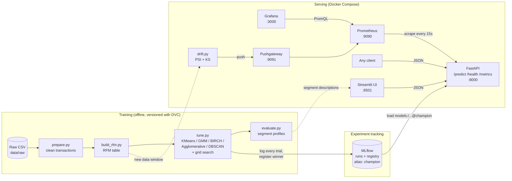

# Customer Segmentation MLOps Pipeline

Unsupervised **customer segmentation** on the Kaggle _Online Retail II_ dataset. Every customer is described by three numbers (RFM), several clustering algorithms are compared and tuned, the best one is registered as the **champion**, and it is served through a **FastAPI** service with a **Streamlit** UI and full monitoring.

**Dataset:** [Online Retail II (UCI) on Kaggle](https://www.kaggle.com/datasets/mashlyn/online-retail-ii-uci) - about 1.07 million transactions of a UK online gift retailer (2009-12-01 to 2011-12-09).

| RFM feature   | Meaning                                 |
| ------------- | --------------------------------------- |
| **Recency**   | days since the customer's last purchase |
| **Frequency** | number of distinct invoices             |
| **Monetary**  | total money spent                       |

---

## 1. Architecture



A PNG copy of the diagram is in [`docs/architecture.png`](docs/architecture.png).

**How to read it:** the left box turns raw sales into a champion model and records everything in MLflow. The right box loads that champion and answers requests. Prometheus and Grafana watch the API, and the drift job tells you when new customers no longer look like the training data. CI (GitHub Actions) re-runs a tiny version of the whole chain on every push: `ruff` -> `pytest` -> smoke pipeline on synthetic data -> quality gate.

---

## 2. MLOps skills demonstrated

| Skill                            | How it is done here                                                                                                                                                 |
| -------------------------------- | ------------------------------------------------------------------------------------------------------------------------------------------------------------------- |
| **Data and pipeline versioning** | DVC tracks the raw CSV and the four-stage pipeline (`dvc.yaml`); parameters live in `configs/params.yaml`, so changing a parameter re-runs only the affected stages |
| **Reproducibility**              | fixed random seeds, pinned config files, `git_commit` and `data_sha256` tags on every MLflow run                                                                    |
| **Experiment tracking**          | MLflow with a parent run per tuning session and a nested run per algorithm and parameter combination (parameters, metrics, plots)                                   |
| **Model selection with rules**   | silhouette, Davies-Bouldin and Calinski-Harabasz are logged; the winner must pass minimum/maximum cluster counts, a minimum cluster share and a maximum noise share |
| **Model registry**               | the winner is registered as `customer-segmentation` with the alias `champion`; serving always asks for the alias, not a version number                              |
| **Model packaging**              | one scikit-learn pipeline (log transform, scaler, model) so training and serving cannot drift apart                                                                 |
| **API serving**                  | FastAPI with input validation, single and batch prediction, health and readiness endpoints, a batch size limit and an optional API key                              |
| **UI**                           | Streamlit app for one customer or a CSV upload, with friendly error messages                                                                                        |
| **Observability**                | Prometheus metrics (request count, latency, predictions per segment), a provisioned Grafana dashboard and alert rules                                               |
| **Drift detection**              | Population Stability Index and Kolmogorov-Smirnov tests between a reference and a new window, pushed to Pushgateway                                                 |
| **Containerisation**             | Docker images for the API, the UI and MLflow, wired together with Docker Compose                                                                                    |
| **Testing and quality**          | 24 pytest tests, ruff linting, a smoke pipeline on synthetic data                                                                                                   |
| **CI**                           | GitHub Actions: lint, tests, smoke pipeline, then a quality gate that fails the build if the metrics are too weak                                                   |

---

## 3. Models and metrics

Algorithms tried (grids in `configs/tuning.yaml`): **KMeans, Gaussian Mixture, BIRCH, Agglomerative, DBSCAN**.

- Features are `log1p`-transformed and standardised, because RFM is heavily skewed.
- **Silhouette** is the selection metric (computed on a 10,000-customer sample for speed). It tends to favour only two clusters, so `min_clusters: 3` is recommended if you want business-friendly segments.
- DBSCAN and Agglomerative cannot predict new points, so the winner is wrapped with a nearest-neighbours classifier for serving. The real algorithm name is stored in the run tag `best_algorithm`.

---

## 4. Project structure

```
.
├── .github/workflows/ci.yml        lint + tests + smoke pipeline + quality gate
├── configs/
│   ├── params.yaml                 prepare / feature settings (DVC params)
│   ├── tuning.yaml                 algorithms, grids, selection rules, MLflow settings
│   └── tuning_smoke.yaml           tiny version for CI and quick checks
├── data/                           raw / processed / features (DVC, not git)
├── deploy/model/                   exported champion (created by export_champion.py, not in git)
├── docker/
│   ├── Dockerfile.api  Dockerfile.ui  Dockerfile.mlflow
│   └── docker-compose.yml          mlflow, api, ui, prometheus, pushgateway, grafana
├── docs/PHASES.md                  step-by-step build guide
├── monitoring/
│   ├── prometheus/{prometheus.yml, alerts.yml}
│   └── grafana/{provisioning/, dashboards/segmentation.json}
├── notebooks/01_eda.ipynb
├── scripts/
│   ├── make_synthetic_data.py      fake data with the same schema
│   ├── check_metrics.py            quality gate used by CI
│   └── export_champion.py          copy the champion out of MLflow into deploy/model
├── src/
│   ├── data/prepare.py             clean the transactions
│   ├── features/build_rfm.py       build the RFM table
│   ├── models/tune.py              try every algorithm, log to MLflow, register the champion
│   ├── models/evaluate.py          segment sizes, RFM means, persona hints
│   ├── monitoring/drift.py         PSI / KS drift report
│   └── serving/app.py              FastAPI + Prometheus metrics
├── tests/                          test_pipeline.py  test_deploy.py  test_ui.py
├── ui/                             streamlit_app.py  segment_client.py
├── dvc.yaml  Makefile  pytest.ini  ruff.toml
└── requirements*.txt
```

---

## 5. How the project was built (steps)

| Step | What was done                                                                   | Main files                                        |
| ---- | ------------------------------------------------------------------------------- | ------------------------------------------------- |
| 1    | Chose the dataset and set up the repo, conda environment and Git                | `requirements*.txt`, `.gitignore`                 |
| 2    | Explored the data (EDA): missing customers, cancellations, negative quantities  | `notebooks/01_eda.ipynb`                          |
| 3    | Cleaned the transactions                                                        | `src/data/prepare.py`                             |
| 4    | Built the RFM features                                                          | `src/features/build_rfm.py`                       |
| 5    | Tried all algorithms with hyperparameter tuning and logged everything to MLflow | `src/models/tune.py`, `configs/tuning.yaml`       |
| 6    | Profiled the champion segments and gave them readable descriptions              | `src/models/evaluate.py`                          |
| 7    | Put the four steps into a DVC pipeline and tracked the raw data                 | `dvc.yaml`, `configs/params.yaml`                 |
| 8    | Served the champion with FastAPI and exposed Prometheus metrics                 | `src/serving/app.py`                              |
| 9    | Added drift detection                                                           | `src/monitoring/drift.py`                         |
| 10   | Added Prometheus alerts and a Grafana dashboard                                 | `monitoring/`                                     |
| 11   | Containerised everything with Docker Compose                                    | `docker/`                                         |
| 12   | Wrote tests, lint rules and the CI workflow                                     | `tests/`, `ruff.toml`, `.github/workflows/ci.yml` |
| 13   | Built the Streamlit UI on top of the API                                        | `ui/`                                             |
| 14   | Exported the champion so the API can run without an MLflow server               | `scripts/export_champion.py`                      |

The full walkthrough with the code for each file is in [`docs/PHASES.md`](docs/PHASES.md).

---

## 6. Results (screenshots)

Save your screenshots in `docs/screenshots/` with the file names below and they will show up here. Until a file exists, GitHub shows a broken-image icon, so replace or delete the lines you don't use.

### 6.1 Streamlit: one customer

Enter recency, frequency and monetary, then click **Find segment**.


### 6.2 Streamlit: upload a file

Upload a CSV with the header `recency,frequency,monetary` and download the result.


### 6.3 Streamlit: about the segments


### 6.4 API docs (FastAPI /docs)


### 6.5 MLflow: algorithm comparison


### 6.6 Grafana dashboard


### 6.7 Result summary (fill in)

| Item                                               | Value    |
| -------------------------------------------------- | -------- |
| Winning algorithm                                  |          |
| Number of segments                                 |          |
| Silhouette score                                   |          |
| Davies-Bouldin                                     |          |
| Calinski-Harabasz                                  |          |
| Example: recency 5 / frequency 30 / monetary 20000 | segment: |

---

## 7. Run it

All commands are for **Git Bash on Windows** (Linux and macOS work the same way). Python 3.11 is recommended.

### 7.1 Set up

```bash
cd "/d/visual studio/Online_Retail"
source /c/Users/v/miniconda3/etc/profile.d/conda.sh
conda activate retail-mlops
pip install -r requirements-dev.txt -r requirements-ui.txt
```

### 7.2 Get the data

Put `online_retail_II.csv` in `data/raw/` (download it from Kaggle), or create fake data with the same columns:

```bash
python scripts/make_synthetic_data.py --customers 1500 --output data/raw/online_retail_II.csv
```

### 7.3 Train

```bash
# terminal 1: MLflow server (UI at http://localhost:5000)
docker compose -f docker/docker-compose.yml up -d mlflow

# terminal 2: the pipeline (prepare -> features -> tune -> evaluate)
dvc repro
```

`dvc repro` only re-runs stages whose inputs changed. You can also run the stages one by one with `python src/data/prepare.py`, `python src/features/build_rfm.py`, `python src/models/tune.py` and `python src/models/evaluate.py`.

### 7.4 Serve: API and UI

The simplest way needs no MLflow server at run time. Export the champion once, then start the two programs in two terminals.

```bash
python scripts/export_champion.py          # creates deploy/model/
```

```bash
# terminal 1: API  ->  http://localhost:8000/docs
MODEL_PATH=deploy/model uvicorn src.serving.app:app --port 8000

# terminal 2: UI   ->  http://localhost:8501
API_URL=http://localhost:8000 streamlit run ui/streamlit_app.py
```

To load the champion straight from MLflow instead, leave out `MODEL_PATH` and keep the MLflow server running (`MLFLOW_TRACKING_URI` defaults to the value in the config).

### 7.5 API endpoints

| Endpoint              | Purpose                                   |
| --------------------- | ----------------------------------------- |
| `GET /live`           | the process is up                         |
| `GET /health`         | model loaded, source, algorithm, warnings |
| `GET /segments`       | segment descriptions                      |
| `POST /predict`       | one customer                              |
| `POST /predict/batch` | many customers (size-limited)             |
| `POST /reload`        | reload the champion                       |
| `GET /metrics`        | Prometheus metrics                        |

Example (add `-H "x-api-key: <key>"` if you set `API_KEY`):

```bash
curl -X POST http://localhost:8000/predict \
  -H "Content-Type: application/json" \
  -d '{"recency":5,"frequency":30,"monetary":20000}'
```

Sample inputs for the UI:

| Customer type | Recency | Frequency | Monetary |
| ------------- | ------- | --------- | -------- |
| Best / VIP    | 5       | 30        | 20000    |
| Loyal regular | 30      | 8         | 2500     |
| Occasional    | 90      | 3         | 600      |
| Lapsed        | 250     | 2         | 300      |

For file upload use a CSV with the header `recency,frequency,monetary`.

### 7.6 Whole stack with monitoring

```bash
docker compose -f docker/docker-compose.yml up -d
```

| Service      | URL                                              |
| ------------ | ------------------------------------------------ |
| Streamlit UI | http://localhost:8501                            |
| FastAPI docs | http://localhost:8000/docs                       |
| MLflow       | http://localhost:5000                            |
| Prometheus   | http://localhost:9090                            |
| Pushgateway  | http://localhost:9091                            |
| Grafana      | http://localhost:3000 (admin / admin, change it) |

### 7.7 Drift check

```bash
make drift-demo
```

It compares two 12-month windows and pushes PSI/KS values to Pushgateway so Grafana can show them. With the real Online Retail II data, two years of seasonal sales will show some drift by nature, so use it to see the mechanism, not as a verdict.

### 7.8 Tests and lint

```bash
ruff check src tests scripts ui
pytest -q
```

---

## 8. Notes and limits

- The Kaggle file is large; DVC keeps it out of git.
- The default config has `min_clusters: 2`; raise it to 3 for more useful business segments.
- The API key is optional locally. If you expose the API publicly, set `API_KEY` and send it in the `x-api-key` header.
- The Streamlit UI has no login of its own.
- The Grafana password in the compose file is a placeholder; change it before sharing the stack.
